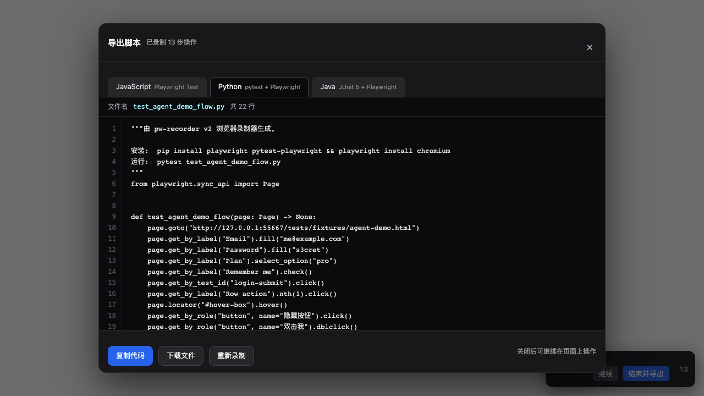
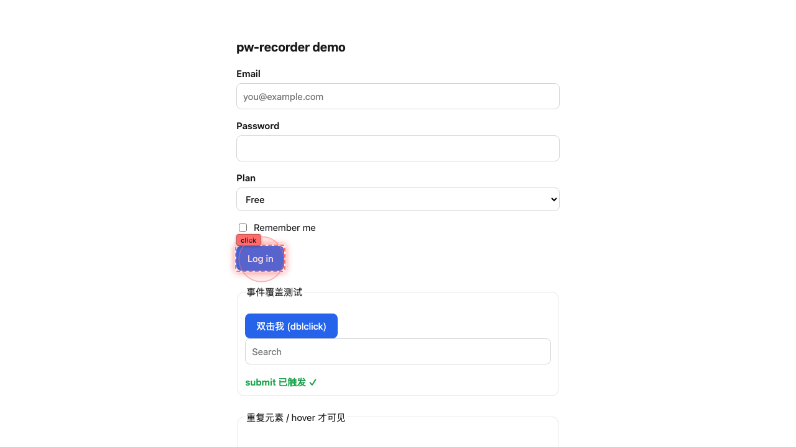
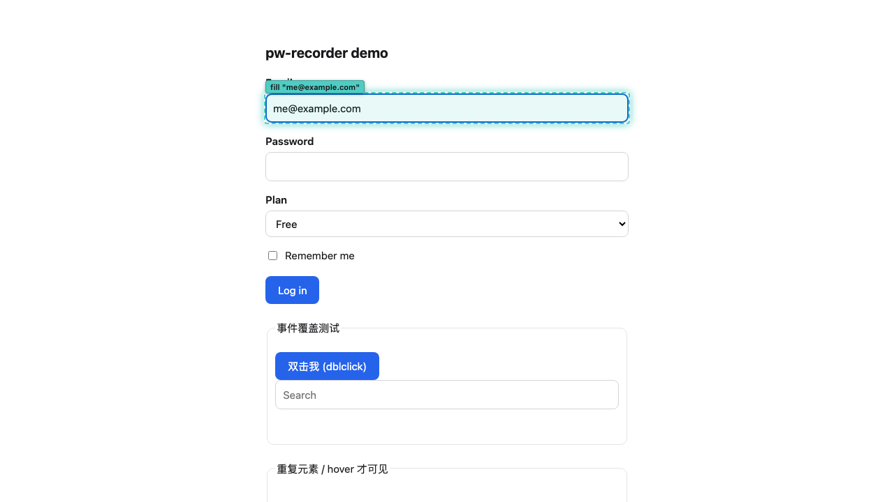

# pw-recorder

把浏览器变成「可录制的 IDE」：右下角悬浮面板随时开/关录制，终端命令也能控制，用户操作实时转换为 Playwright Test 代码，一键导出 `.spec.js` 供下次复用。

本质是一个可嵌入的迷你 `playwright codegen`——但可以在已运行的服务、需登录态、内网环境中录制，并支持录制中途随时暂停/继续。

有两种用法：

| | v1 CLI 录制器 | v2 浏览器 Agent（引入即录） |
|---|---|---|
| 怎么用 | `node record.js --url …` 起一个受控浏览器 | 页面里引一个 `<script>`，右下角直接录 |
| 需要 Node / Playwright | 需要 | **不需要**，纯浏览器 |
| 适用场景 | 本地开发、需要干净 context、要 CLI 控制 | 已上线的站点、给别人演示、录完即导出 |
| 导出语言 | JavaScript | JavaScript / Python / Java |

## 目录结构

```
pw-recorder/
├── record.js                       # CLI 启动入口
├── playwright.config.js            # 只跑录出来的脚本时用（npm test）
├── package.json
├── src/
│   ├── injected.js                 # 注入页面的事件捕获脚本（v1/v2 共用）
│   ├── panel.js                    # v1 的右下角控制面板
│   ├── highlight-client.js         # 页面内操作高亮（录制/回放共用）
│   ├── playback-highlight.js       # 生成回放高亮支持文件 _pw-highlight.js
│   ├── CodeGenerator.js            # 动作 → 语言无关的 locator 描述 + JS 代码
│   ├── lang/                       # python.js / java.js / index.js —— 多语言导出
│   ├── agent/                      # agent.js（浏览器内录制器）/ ui.js（控件+导出弹窗）
│   ├── Recorder.js                 # v1 核心录制器（Node 侧）
│   ├── url.js                      # 地址补全（www.x.com → https://…）
│   └── browserPath.js              # 自动定位项目内安装的浏览器
├── dist/pw-agent.js                # v2 浏览器 bundle（npm run build:agent 生成，已提交）
├── extension/                      # v2 Chrome 扩展壳（manifest + 生成的 bundle）
├── scripts/
│   ├── build-agent.js              # 迷你打包器（零依赖，含漂移检查）
│   ├── serve.js                    # 手动体验用的静态服务
│   ├── smoke.js                    # 动作→代码生成自检（不开浏览器）
│   ├── e2e.js                      # v1 无头端到端自检
│   ├── agent-e2e.js                # v2 端到端自检（引入→录制→弹窗导出→真回放/编译）
│   ├── highlight-check.js          # 高亮自检 + 截图取证
│   ├── record-demo.js              # 无头录制 demo 页面，产出可回放的 spec
│   ├── record-live.js              # 录制真实站点（配 driver 脚本）
│   └── live/todomvc.js             # 真实站点示例 driver（TodoMVC）
└── tests/
    ├── fixtures/                   # 离线示例页（demo.html / agent-demo*.html）
    ├── recorded/                   # v1 导出目录（含生成的支持文件）
    └── generated/                  # v2 Agent 导出的三语言脚本
```

## 安装

```bash
git clone https://github.com/lxf-lxf/pw-recoder.git
cd pw-recoder
npm install
npm run install-browser      # 下载 Chromium（约 150MB，首次需要）
```

> 仓库名是 `pw-recoder`（少一个 r），包名/CLI 仍是 `pw-recorder`。

> 受限环境（沙箱/CI）里浏览器可能装在项目内的 `./.pw-browsers`。
> 只要显式设置过 `PLAYWRIGHT_BROWSERS_PATH` 就以你为准，否则脚本会自动使用该目录。

## v1 用法：启动录制

```bash
node record.js --url https://example.com --output tests/recorded/login.spec.js --title "登录流程"
```

参数：

| 参数 | 默认值 | 说明 |
|------|--------|------|
| `--url` | `about:blank` | 起始页面，**协议头可省略**（见下） |
| `--output` | `tests/recorded/flow.spec.js` | 导出路径 |
| `--title` | `recorded flow` | 生成的 `test(...)` 名称 |
| `--headless` | 关 | 无头运行（CI 自检用，也可用 `PW_RECORDER_HEADLESS=1`） |

地址会自动补协议头，不用手打：

```bash
node record.js --url www.baidu.com        # → https://www.baidu.com
node record.js --url localhost:3000       # → http://localhost:3000   （本机/内网走 http）
node record.js --url 192.168.1.5:5173     # → http://192.168.1.5:5173
node record.js --url example.com:8443     # → https://example.com:8443
node record.js --url about:blank          # 原样保留
```

浏览器打开后，页面上的操作会被实时捕捉，右下角面板显示动作计数。

本地先拿示例页面玩一下（不联网）：

```bash
npm run demo          # 打开 demo.html 并开始录制
npm run demo:record   # 无头自动录一遍 → tests/recorded/demo.spec.js
npm run demo:replay   # 回放刚录出来的脚本
npm run replay-check  # 录制 + 回放，一步验证闭环
```

## v1 用法：录真实站点（可回归）

`npm run record` 需要你手动操作；如果想让录制可重复（CI、回归），用 driver 脚本：

```bash
npm run live:record   # 无头录制 TodoMVC，导出 todomvc.spec.js
npm run live:verify   # 录制 + 回放 + 断言终态
```

自己写一个 driver（`scripts/live/<名字>.js`）：

```js
module.exports = async function (page) {
  await page.locator('input.new-todo').fill('buy milk');
  await page.locator('input.new-todo').press('Enter');
};

// 可选：导出 snapshot 后，--verify 会额外生成带终态断言的校验脚本
module.exports.snapshot = async (page) =>
  page.locator('.todo-list li').evaluateAll((els) => els.map((el) => el.textContent.trim()));

// 然后：
// node scripts/record-live.js --url <url> --driver scripts/live/<名字>.js --verify
```

`--verify` 的价值：**"回放没报错"不等于"录对了"**。`.nth(1)` 万一指错条目，回放照样通过。
所以它会先不录制跑一遍取终态，再回放录制脚本比对同一个终态。

## v2：浏览器内 Agent（引入即录）

参考 [alibaba/page-agent](https://github.com/alibaba/page-agent) 的形态：单个 IIFE bundle，页面里引一行就开始录，不依赖 Node 和 Playwright。



### 三种引入方式

**① script 标签**（自己的站点，最省事）

```html
<script src="https://cdn.jsdelivr.net/gh/lxf-lxf/pw-recoder@v2.0/dist/pw-agent.js"></script>
```

引入即自动挂控件并开始录制。想控制时机：

```html
<!-- 只挂 API，什么都不显示 -->
<script src="/dist/pw-agent.js?autoInit=false"></script>
<script>
  PWAgent.init({ autoStart: false, title: '下单流程' });  // 手动初始化
  PWAgent.start();                                        // 手动开录
</script>
```

**② 书签脚本**（任意页面，但受目标站 CSP 限制）

把下面这段存成书签，在目标页面点一下：

```js
javascript:(function(){var s=document.createElement('script');s.src='https://cdn.jsdelivr.net/gh/lxf-lxf/pw-recoder@v2.0/dist/pw-agent.js';document.body.appendChild(s)})()
```

**③ Chrome 扩展**（任意页面，不受 CSP 限制）

```bash
npm install && npm run build:agent     # 生成 extension/pw-agent.js
# chrome://extensions → 打开"开发者模式" → "加载已解压的扩展程序" → 选 extension/ 目录
```

扩展注入时**不会自动开录**（否则每个页面都自动录会很烦），点右下角"开始"即可。

### 配置

`<script>` 上可以用 `data-*`，也可以用查询参数，两者等价：

| 参数 | 默认 | 说明 |
|------|------|------|
| `autoInit` | `true` | `false` 时只挂 `window.PWAgent`，不显示任何 UI |
| `autoStart` | `true` | 引入后是否立刻开始录制（扩展注入时默认 `false`） |
| `title` | `recorded flow` | 导出脚本的标题（决定文件名/函数名/类名） |
| `highlight` | `true` | 录制时是否高亮被捕获的操作 |
| `persist` | `true` | 是否把录制状态存 sessionStorage（跨页续录的基础） |

```html
<script src="/dist/pw-agent.js" data-title="登录流程" data-highlight="false"></script>
```

### 跨页续录

录制状态写在 `sessionStorage`（同一标签页），刷新或跳转后自动接上。
如果换页是被录下来的点击带过去的，不会再补一条 `goto`（交给 Playwright 的 `click()` 自动等待导航）；
如果是用户手输地址跳的，才会补 `goto`。

### 导出弹窗

点"结束并导出"弹出预览窗口：**JavaScript / Python / Java** 三个标签页，带行号、文件名、复制、下载、重新录制。

| 语言 | 框架 | 产物 |
|------|------|------|
| JavaScript | Playwright Test | `agent-demo-flow.spec.js` |
| Python | pytest + Playwright (sync) | `test_agent_demo_flow.py` |
| Java | JUnit 5 + Playwright | `AgentDemoFlowTest.java` |

三种语言共用同一套选择器决策（`resolveLocator`），所以选出来的元素完全一致：

```js
await page.getByLabel('Email').fill('me@example.com');
await page.getByLabel('Row action').nth(1).click();
await page.getByRole('button', { name: '隐藏按钮' }).click();
```

```python
page.get_by_label("Email").fill("me@example.com")
page.get_by_label("Row action").nth(1).click()
page.get_by_role("button", name="隐藏按钮").click()
```

```java
page.getByLabel("Email").fill("me@example.com");
page.getByLabel("Row action").nth(1).click();
page.getByRole(AriaRole.BUTTON, new Page.GetByRoleOptions().setName("隐藏按钮")).click();
```

Java 的 `AriaRole` 是枚举：角色名不在枚举里（页面自定义 role）会自动退化成 CSS 选择器，保证生成的代码一定能编译。

### 手动体验

```bash
npm run agent:demo
# → http://127.0.0.1:4173/tests/fixtures/agent-demo.html
```

### 重新跑 UI 自动化测试

导出的脚本本身就是可重跑的测试，不用再经过录制器：

```bash
# JavaScript：放进 tests/generated/ 直接跑
npx playwright test --config playwright.generated.config.js

# Python
pip install playwright pytest-playwright && playwright install chromium
pytest tests/generated/test_agent_demo_flow.py

# Java
mvn test -Dtest=AgentDemoFlowTest     # 依赖 com.microsoft.playwright:playwright + junit-jupiter
```

`npm run v2:check` 会把这些**真的跑一遍**：录 → 导出三语言 → JavaScript 用 Playwright 回放 → Python `py_compile` → Java `javac` 编译。

## 操作高亮

录制和回放都会把操作目标框出来。视觉参考 [browser-use 的 python_highlights.py](https://github.com/browser-use/browser-use/blob/main/browser_use/browser/python_highlights.py)：
按元素类型着色的**虚线框** + 操作名标签，点击类操作额外补一圈涟漪。

| 元素 | 颜色 |
|------|------|
| `button` | `#FF6B6B` 红 |
| `input` | `#4ECDC4` 青 |
| `select` | `#45B7D1` 蓝 |
| `a` | `#96CEB4` 绿 |
| `textarea` | `#FF8C42` 橙 |
| 其它 | `#DDA0DD` 紫 |

**录制时**：每个被捕获的操作立刻在页面上框一下，用来确认"这一步录到了"。标签显示动作名与内容（如 `fill "me@example.com"`）。



**回放时**：生成的 spec 顶部会自动接入支持文件，`test` 里只多一行：

```js
const { test, expect } = require('@playwright/test');

let hl = (p) => p;
try { hl = require('./_pw-highlight'); } catch (e) {}   // 支持文件缺失 → 自动降级为不高亮

test('demo flow', async ({ page: rawPage }) => {
  const page = hl(rawPage);
  await page.getByLabel('Email').fill('me@example.com');   // 下面每一行都保持原样
  ...
});
```

接入方式是 Proxy：动作方法被调用前先框出目标，**不需要给每个动作插一句高亮调用**，录制出来的代码一个字符都不用改。



```bash
# 高亮只在有头回放时看得见
npx playwright test tests/recorded/demo.spec.js --headed

# 想看得更清楚（默认停留 900ms）
PW_HL_HOLD=2500 npx playwright test tests/recorded/demo.spec.js --headed
```

不想用高亮：录制时加 `--no-highlight`，会生成完全干净的纯 codegen 风格脚本（也不写支持文件）。
也可以直接删掉 `tests/recorded/_pw-highlight.js`，spec 会自动降级成不高亮。

重新生成截图证据：`npm run highlight:check`（截图写入 `docs/`）。

## v1 用法：两种控制方式

**页面悬浮面板**：`Pause / Resume`、`Save`、`Reset`，右侧是已录动作数。面板状态与终端命令双向同步，跳转/刷新后会自动对齐。

**终端命令**：

```
goto <url>  导航到指定地址并开始录制
start       继续录制
stop        暂停录制
save        导出 .spec.js
list        查看已录动作
reset       清空
quit        退出
```

> 首跳打不开（服务没起、端口写错）时录制器**不会退出**：浏览器和录制器保持就绪，
> 报一行原因，然后把服务拉起来、敲 `goto <url>` 就能继续录。
> 失败的地址不会留在动作列表里。

## v1 用法：导出结果示例

下面这段是 `npm run replay-check` 的真实产物，回放通过（1 passed）：

```js
const { test, expect } = require('@playwright/test');

test('demo flow', async ({ page }) => {
  await page.goto('file:///.../tests/fixtures/demo.html');
  await page.getByLabel('Email').fill('me@example.com');
  await page.getByLabel('Password').fill('s3cret');
  await page.getByLabel('Plan').selectOption('pro');
  await page.getByLabel('Remember me').check();
  await page.getByTestId('login-submit').click();
  await page.getByTestId('search').fill('hello');
  await page.getByTestId('search').press('Enter');
});
```

## 复用

```bash
npx playwright test tests/recorded/login.spec.js
# 或
npm test
```

## 自检

| 命令 | 覆盖范围 | 是否需要浏览器 |
|------|---------|--------------|
| `npm run smoke` | 动作 → 代码生成、选择器优先级、`.nth()`、转义 | 否 |
| `npm run e2e` | 注入 → 事件捕获 → 顺序 → 面板 → 重复元素/双击/hover 回归 | 是（无头） |
| `npm run highlight:check` | 录制高亮 / 回放高亮 / 高亮不污染录制 + 截图取证 | 是（无头） |
| `npm run replay-check` | 录制 → 导出 → 真实回放（本地 fixture） | 是（无头） |
| `npm run live:verify` | 真实站点录制 → 回放 → 终态断言 | 是（无头，需联网） |
| `npm run v2:check` | bundle 是否最新 + v2 全链路（导出三语言 → 回放 / py_compile / javac） | 是（无头；Java 编译需联网取 jar） |
| `npm run e2e:agent` | 只跑 v2 全链路 | 同上 |

## 关键设计点

| 问题 | 处理方式 |
|------|---------|
| 跨导航保持录制 | `addInitScript` 每次新文档都注入，`load` 事件里重新打开开关并同步面板状态 |
| 减少冗余 fill | `input` 事件 400ms 防抖 + `blur` / `pagehide` 立即 flush，合并成一次 `fill()` |
| 动作顺序 | 任何记录其他动作的处理器（`click`/`dblclick`/`keydown`/`change`）都先 flush 未落盘的输入，否则"输完立刻点按钮"会生成反序脚本 |
| 生成稳定选择器 | 优先级：`data-testid` → 可访问名（`aria-label` 或 `<label for>` / 外层 `<label>`）→ `placeholder` → `getByRole` → `#id` → `[name]` → CSS 路径 |
| **同类元素重复** | 录制时统计同一选择器命中几个元素、当前是第几个，`n > 1` 时自动补 `.nth(i)`。少了这步，列表页回放必然 strict mode violation（真实站点第一条就撞上） |
| **双击去重** | 浏览器在 `dblclick` 前必定先发两次 `click`，Node 侧丢弃它们。否则在"点标题即切换状态"的页面（TodoMVC）回放时语义会被改掉 |
| **hover 才可见的元素** | 解析样式表里的 `:hover` 规则，若点击目标靠祖先 `:hover` 才显示（如列表行的删除按钮），在 `click` 前自动补一步 `hover(祖先)` |
| `:hover` 检测的坑 | 不能用 `if (rule.cssRules)` 判断分组规则——Chrome 112+ 起普通样式规则也有 `cssRules`（空列表但 truthy），会静默跳过所有规则；应反过来用 `selectorText` 是否存在来判断 |
| 点击落在图标上 | 命中 `<span>`/`<svg>` 时向上找最近的 `button`/`a`/`[role]`/`[data-testid]` 祖先，避免生成不可点击的深层选择器 |
| 避免重复动作 | 复选框的 `click` 不单独记录（由 `change` → `check/uncheck`）；输入框/下拉的聚焦点击不记录（由 `fill`/`selectOption` 表示） |
| 避免录到面板本身 | 面板元素打 `data-pw-recorder-ui`，事件捕获时直接过滤 |
| **高亮层不污染录制** | 高亮覆盖层 `pointer-events:none` + `data-pw-recorder-ui`，点不到也不会被录成一步动作 |
| 高亮目标在首屏外 | 回放时 Playwright 要到动作执行才滚动，高亮跑在它前面，所以先自己 `scrollIntoView`；越界时夹到视口边缘而不是静默跳过 |
| 高亮时长可调 | 淡入淡出固定 90/220ms，只延长完全可见的停留时间，否则调大 `PW_HL_HOLD` 做演示时淡入会跟着变慢，截图都是半透明的 |
| **导航容错** | 首跳失败不崩、不记无效 `goto`，页面落到 `about:blank` 后仍可 `goto` 继续。失败的导航会留下 `chrome-error` 页，其收尾会"打断"紧随的导航（且**级联**），所以对"被打断"带间隔重试 4 次；连不上/超时这类真错误立即抛出，不空转 |
| **地址补全** | `www.baidu.com` 这类不带协议头的写法交给 `src/url.js` 补全（`page.goto` 只收绝对 URL）。`localhost:3000` 有歧义——按 RFC 看着像 `scheme:path`，判据是"冒号后全是数字则视为端口"，本机/内网走 http、公网走 https |
| REPL 命令串行 | readline 不等异步命令完成就派发下一行，粘贴多行会交错执行，用 Promise 链串行化 |
| 开关可控 | 页面面板 + 终端命令 + `Recorder.stop()/resume()` API 三种方式 |
| 点击触发导航 | 不单独记录 `goto`，交给 Playwright 的 `click()` 自动等待导航 |

## v1 用法：作为库引入

```js
const { chromium } = require('@playwright/test');
const Recorder = require('./src/Recorder');

const browser = await chromium.launch({ headless: false });
const page = await browser.newPage();

const recorder = new Recorder(page, {
  title: 'checkout flow',
  outputFile: 'tests/recorded/checkout.spec.js',
});

await recorder.start('https://shop.example.com');
// ... 用户操作 ...
await recorder.stop();
await recorder.export();
```

## 已知边界

- 文件上传、拖拽、`scroll`、iframe 内事件、`contextmenu` 目前不记录。
- `hover` 只在"点击目标靠 `:hover` 才可见"时按需补一步；纯 hover 查看的交互（悬停提示）不会记录。
- `:hover` 检测需要能读到样式表规则；跨域 CDN 的 CSS 读不到 `cssRules`，那种情况下会退化成不补 hover。
- `.nth(i)` 的序号是**录制时**的页面状态决定的；如果回放时列表长度不同，序号可能不再指向同一条目（此时 Playwright 会明确报超时，不会静默点错）。
- 需要登录态的流程：用 `--url` 指到登录页先手动登录，或在 `Recorder` 上先用 `context` 注入 storageState。
- 输入内容含敏感信息时会原样写进 `.spec.js`，注意别把凭据提交进仓库。
